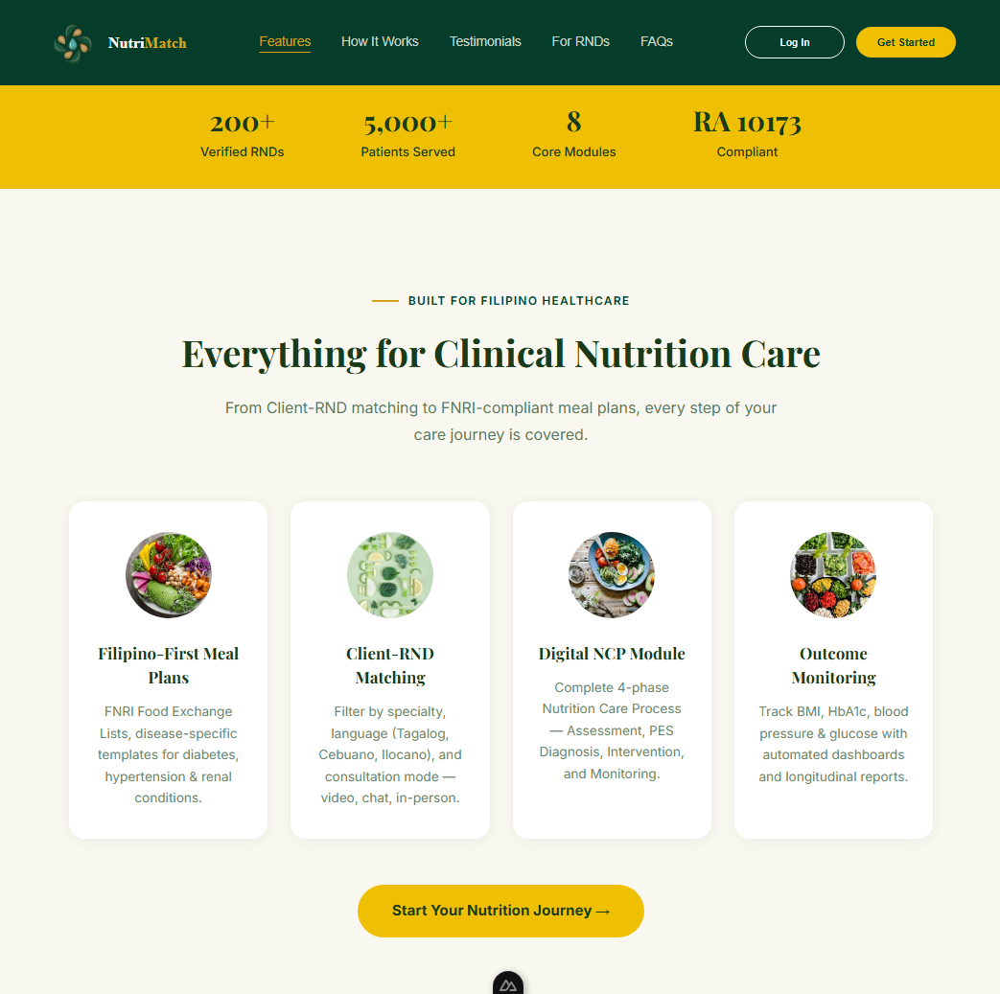

# NutriMatch

**Web-Based Clinical Nutrition Consultation Management System**

Capstone project — STI College Davao, BSIT. Connects clients with licensed Registered Nutritionist-Dietitians (RNDs) in the Philippines for structured **Medical Nutrition Therapy (MNT)**, built around the clinical 4-phase **Nutrition Care Process (NCP)**.



- **Backend:** Django 6.1 + Django REST Framework (`backend/`)
- **Frontend:** Nuxt 4 + Tailwind CSS (`frontend/`)
- **Database:** SQLite for local development (a file, nothing to install)

---

## How to run it on your computer

You run **two programs side by side**: the backend (port 8000) and the frontend (port 3000). The steps below take about 10 minutes the first time.

### 1. Install these first

| Tool | Version | Check with |
|---|---|---|
| [Git](https://git-scm.com/downloads) | any | `git --version` |
| [Python](https://www.python.org/downloads/) | **3.13** (tick "Add Python to PATH" when installing) | `python --version` |
| [Node.js](https://nodejs.org/) | **20 or newer** (LTS) | `node --version` |
| [Docker Desktop](https://www.docker.com/products/docker-desktop/) | optional — only for the Messages page | `docker --version` |

### 2. Get the code

```bash
git clone https://github.com/kairu9k/NutriMatch.git
cd NutriMatch
```

### 3. Start the backend (terminal #1)

**Windows (PowerShell):**

```powershell
cd backend
python -m venv .venv
.\.venv\Scripts\python.exe -m pip install -r requirements.txt
copy .env.example .env
.\.venv\Scripts\python.exe manage.py migrate
.\.venv\Scripts\python.exe manage.py seed_demo
.\.venv\Scripts\python.exe manage.py runserver
```

**macOS / Linux:**

```bash
cd backend
python3 -m venv .venv
.venv/bin/python -m pip install -r requirements.txt
cp .env.example .env
.venv/bin/python manage.py migrate
.venv/bin/python manage.py seed_demo
.venv/bin/python manage.py runserver
```

> Always run Python through `.venv` like above (not plain `python manage.py …`), so it uses the project's packages.

- `migrate` creates the database (`backend/db.sqlite3`).
- `seed_demo` fills it with demo accounts, appointments, meal plans, invoices and payouts — see [Demo accounts](#demo-accounts).
- Leave this terminal open. It should say `Watching for file changes…` with no red error — the backend is now at `http://localhost:8000`. Each request your browser makes shows up here as a line.

### 4. Start the frontend (terminal #2)

```bash
cd frontend
npm install
```

Then create the frontend's `.env` file:

- Windows: `copy .env.example .env`
- macOS / Linux: `cp .env.example .env`

```bash
npm run dev
```

Open **http://localhost:3000** in your browser. Use `localhost`, not `127.0.0.1` — the backend only accepts requests from those exact addresses.

### 5. (Optional) Reminders on a schedule

Reminders (consultations, payments, meal logging, RND reminders) are also sent whenever a client opens the app, so nothing extra is needed to test them. To send them on a timer like a real server would, run in a third terminal:

```bash
.\.venv\Scripts\python.exe manage.py send_reminders --loop 300     # Windows — every 5 minutes
.venv/bin/python manage.py send_reminders --loop 300               # macOS / Linux
```

### 6. (Optional) Real-time messages — Redis

The **Messages** page needs Redis. Everything else works without it. With Docker Desktop running:

```bash
docker run -d --name nutrimatch-redis -p 6379:6379 --restart unless-stopped redis:7-alpine
```

Run it once; afterwards it starts automatically with Docker. If Messages says it can't connect, open Docker Desktop.

---

## Demo accounts

Every demo account uses the password **`NutriMatchDemo1!`**.

| Role | Email | What's set up |
|---|---|---|
| **Admin** | `admin@nutrimatch.test` | Sign in at **http://localhost:3000/admin/login** |
| RND | `maria.santos@nutrimatch.test` | Carla's RND · GCash payout details · one payout already released, more ready for the next 5th |
| RND | `jose.reyes@nutrimatch.test` | Daniel's RND · has earnings but **no payout details** (shows the reminder) |
| RND | `angela.villanueva@nutrimatch.test` | Not accepting new clients |
| RND | `ramon.delacruz@nutrimatch.test` | Has Elena's booking request waiting over 24 hours |
| RND | `kristine.bautista@nutrimatch.test` | **Application under review** — can't sign in until the admin approves her |
| Client | `ana.cruz@nutrimatch.test` | Brand new — goes through client onboarding |
| Client | `benjamin.garcia@nutrimatch.test` | Screened, hasn't booked an RND yet |
| Client | `carla.mendoza@nutrimatch.test` | Full history with Maria · upcoming visit with **payment due** |
| Client | `daniel.torres@nutrimatch.test` | One paid visit with Jose · meal plan |
| Client | `elena.ramos@nutrimatch.test` | Booked Ramon, waiting for him to confirm |

Clients and RNDs sign in at **http://localhost:3000/login**.

**Reset the demo data** any time (deletes only the `@nutrimatch.test` accounts and rebuilds them; accounts you registered yourself are kept):

```bash
.\.venv\Scripts\python.exe manage.py seed_demo --reset     # Windows
.venv/bin/python manage.py seed_demo --reset               # macOS / Linux
```

---

## What works without any keys

You don't need any passwords or API keys to test most of the app. The `.env` you copied leaves them blank:

| Feature | Without keys | To make it fully work |
|---|---|---|
| Sign-up emails (verification code, password reset) | Nothing is sent — **the email, including the 6-digit code, is printed in the backend terminal (#1)**. Copy the code from there. | Gmail App Password in `GMAIL_HOST_USER` / `GMAIL_HOST_PASSWORD` |
| Registering a **new RND** (PRC license photo) and **profile photos** | Shows "Cloudinary is not configured". Use the demo RNDs instead. | Cloudinary keys in `CLOUDINARY_*` (ask the team lead — never commit them) |
| **Paying** an invoice (PayMongo) | Paying shows "PAYMONGO_SECRET_KEY is not configured." Demo data already has paid invoices. | PayMongo **test** keys in `PAYMONGO_SECRET_KEY` |
| Messages (real-time chat) | Can't send | Redis — [step 6](#6-optional-real-time-messages--redis) |
| Video consultation | Works (free Jitsi, no key) | — |

Registering a new **client** works without any keys — grab the verification code from the backend terminal.

---

## Things to try

**As a client** (`carla.mendoza@…`): Dashboard → My Appointments (pay the upcoming one if PayMongo keys are set) → My Meal Plan → log a meal → Progress Tracker. Or register a brand-new client and go through onboarding + the pre-consultation screening.

**As an RND** (`maria.santos@…`): Dashboard → Appointments → My Patients → Carla → NCP Records → Meal Planning → Profile Settings → **Earnings** (Pending / Posted / Paid out, payout details).

**As the admin** (`admin@nutrimatch.test` at `/admin/login`): Dashboard to-do → **RND Applications** (review and approve Kristine) → Users (open a client's record) → Appointments → Billing & Commission → Payouts → Audit Logs (filters, Export CSV). System Settings is in the account menu (bottom of the sidebar).

Found a bug? Note the account you used, the page, and what you clicked, and send a screenshot.

---

## Testing on your phone

Your phone and laptop must be on the same Wi-Fi — or connect the laptop to your phone's hotspot.

1. Find the laptop's IP address: Windows `ipconfig` (IPv4 Address, e.g. `192.168.1.23`); macOS `ipconfig getifaddr en0`.
2. In `backend/.env`, add that address (keep the existing ones):
   ```
   ALLOWED_HOSTS=localhost,127.0.0.1,192.168.1.23
   CORS_ALLOWED_ORIGINS=http://localhost:3000,http://127.0.0.1:3000,http://192.168.1.23:3000
   ```
3. In `frontend/.env`: `NUXT_PUBLIC_API_BASE=http://192.168.1.23:8000/api`
4. Start the backend with `manage.py runserver 0.0.0.0:8000` and the frontend with `npm run dev -- --host`.
5. On the phone, open `http://192.168.1.23:3000`.

If the phone says "site can't be reached", Windows Firewall is blocking it — allow Python and Node when Windows asks, or use the phone-hotspot option. Undo steps 2–3 when you're done.

---

## After you pull new changes

New code can add packages or database changes. After every `git pull`:

```bash
cd backend
.\.venv\Scripts\python.exe -m pip install -r requirements.txt   # (macOS: .venv/bin/python …)
.\.venv\Scripts\python.exe manage.py migrate
cd ../frontend
npm install
```

If the demo data looks off after a big update, run `seed_demo --reset`.

---

## Troubleshooting

| Problem | Fix |
|---|---|
| "Incorrect email or password" with a demo account | Run `seed_demo` (or `seed_demo --reset`) — the demo accounts are only in your database after seeding. |
| Pages load but say "Could not load…" | The backend (terminal #1) isn't running, or stopped with an error — check that terminal. |
| `Error: That port is already in use` | Another backend is still running. Close it, or on Windows: `Get-Process python \| Stop-Process` in PowerShell. |
| Frontend not on port 3000 (e.g. 3001) | Another `npm run dev` is still running, and the backend only accepts port 3000. Close the other one and start again. |
| `no such table` / `no such column` errors | You skipped `migrate` after pulling — run it. |
| `ModuleNotFoundError` | Run Python through `.venv` (step 3) and re-run `pip install -r requirements.txt`. |
| Messages won't send | Redis isn't running — open Docker Desktop ([step 6](#6-optional-real-time-messages--redis)). |

## Running the automated tests

```bash
cd backend
.\.venv\Scripts\python.exe manage.py test accounts billing core profiles scheduling clinical nutrition
```

(`communication` has 3 extra tests that need Redis running.)

---

## Branching & contribution workflow

- `main` is protected — nothing merges in without a pull request and review.
- Branch off `main` for your work:
  ```bash
  git checkout main
  git pull
  git checkout -b feature/<short-description>
  ```
- Push and open a PR into `main` when ready:
  ```bash
  git push -u origin feature/<short-description>
  ```
- Keep PRs scoped to one feature/fix at a time.
- Never commit `.env` files, `db.sqlite3` or anyone's passwords/keys — they're already in `.gitignore`.
