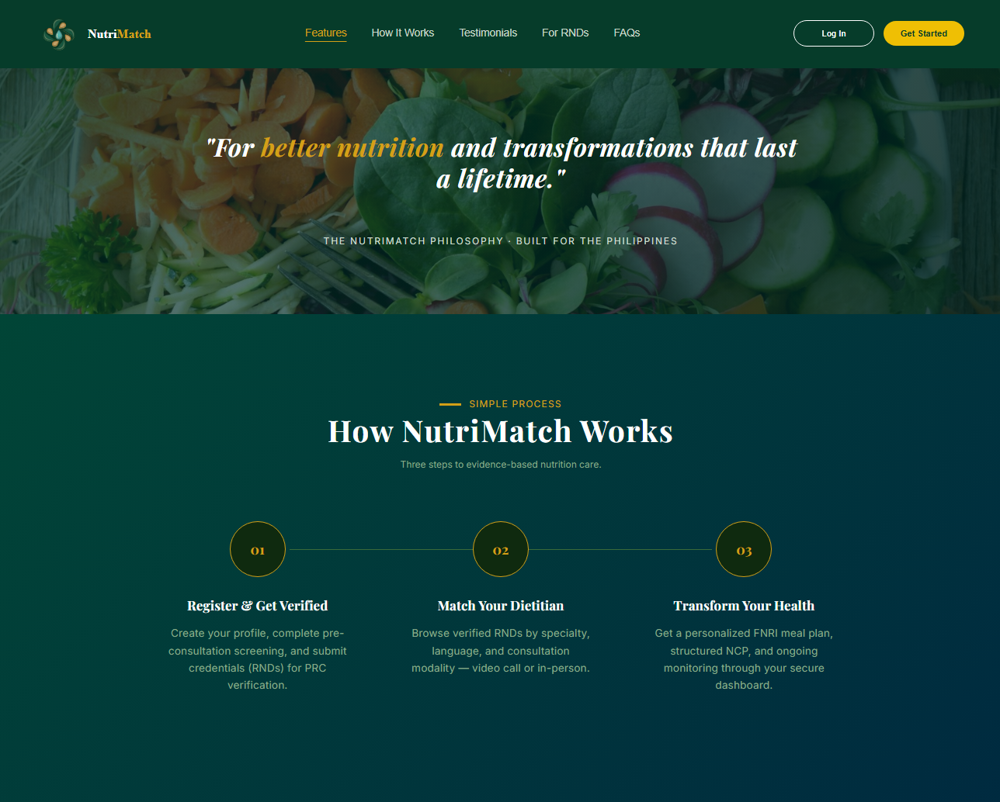

<div align="center">


# NutriMatch

**Web-Based Clinical Nutrition Consultation Management System**

Connecting clients with licensed Registered Nutritionist-Dietitians (RNDs) in the Philippines.


</div>



## About

A capstone project (STI College Davao, BSIT) for **Medical Nutrition Therapy**, built around the clinical 4-phase **Nutrition Care Process**: Assessment → Diagnosis → Intervention → Monitoring & Evaluation.

| Role | What they do |
|---|---|
| **Client** | Pre-consultation screening, book an RND, pay online, follow a weekly FNRI meal plan, log meals, track progress |
| **RND** | Confirm bookings, video consultations, NCP records, meal planning, lab requests, earnings |
| **Admin** | Verify RND licenses, manage users, billing & refunds, payouts, reports, audit log |

Built with the Data Privacy Act (RA 10173) in mind: informed consent, role-based access, private health files and an audit log.

## Quick start

You need **Python 3.13**, **Node.js 20+** and **Git**.

```bash
git clone https://github.com/kairu9k/NutriMatch.git
cd NutriMatch
```

**Backend** (terminal 1, port 8000)

```powershell
cd backend
python -m venv .venv
.\.venv\Scripts\python.exe -m pip install -r requirements.txt
copy .env.example .env
.\.venv\Scripts\python.exe manage.py migrate
.\.venv\Scripts\python.exe manage.py seed              # FNRI food list + settings
.\.venv\Scripts\python.exe manage.py createsuperuser   # the first admin
.\.venv\Scripts\python.exe manage.py runserver
```

> macOS / Linux: use `python3`, `cp` and `.venv/bin/python` instead.

**Frontend** (terminal 2, port 3000)

```bash
cd frontend
npm install
copy .env.example .env      # macOS / Linux: cp
npm run dev
```

Open **http://localhost:3000** (use `localhost`, not `127.0.0.1`).

## Accounts

There is no demo data. Register clients and RNDs in the app.

- **Admin**: the `createsuperuser` account, at `/admin/login`. More admins via Users → Add admin.
- **Client**: Register, enter the 6-digit email code, finish onboarding.
- **RND**: Register, enter the code, then an admin approves the application.

## Keys (optional)

The app runs with the blank `.env`. Add keys to `backend/.env` to turn on:

| Key | Turns on | Without it |
|---|---|---|
| `GMAIL_HOST_USER` / `GMAIL_HOST_PASSWORD` | Real emails | Emails (and codes) print in the backend terminal |
| `CLOUDINARY_*` | RND license, profile, meal and lab photos | Uploads are refused |
| `PAYMONGO_SECRET_KEY` | Online payments and refunds (test mode) | Paying is refused |
| `USDA_FDC_API_KEY` | USDA food search | FNRI foods only |
| `SEMAPHORE_API_KEY` | SMS reminders | Texts are only logged |

Ask the team lead for keys. Never commit `.env`.

## After pulling

```powershell
cd backend
.\.venv\Scripts\python.exe -m pip install -r requirements.txt
.\.venv\Scripts\python.exe manage.py migrate
cd ../frontend
npm install
```

## Tests

```powershell
cd backend
.\.venv\Scripts\python.exe manage.py test
```

## Contributing

- `main` is protected: branch off it (`feature/<name>`) and open a pull request.
- One feature or fix per pull request.
- Never commit `.env`, `db.sqlite3`, passwords or keys.

<div align="center">
<sub>STI College Davao · BSIT Capstone · 2026</sub>
</div>
